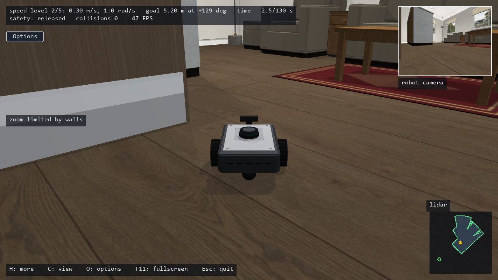
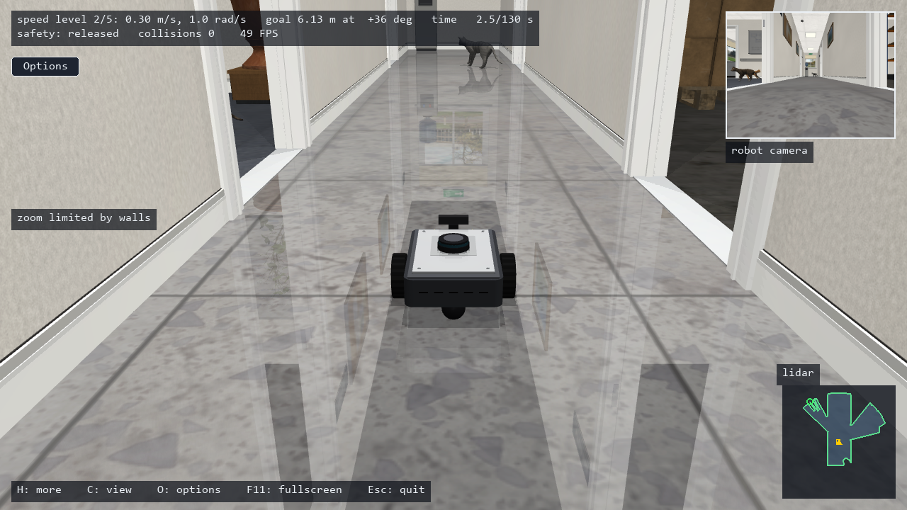
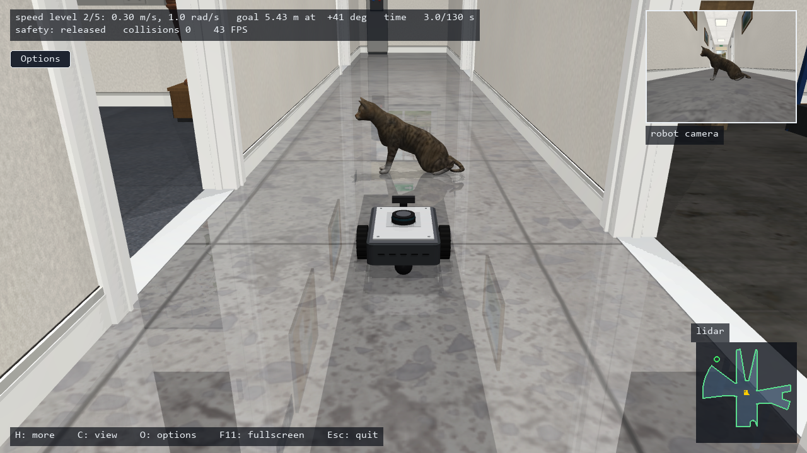
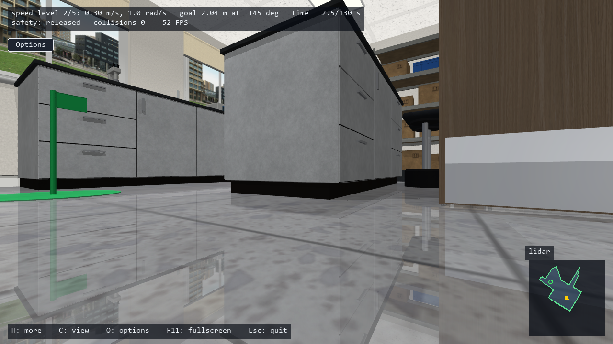
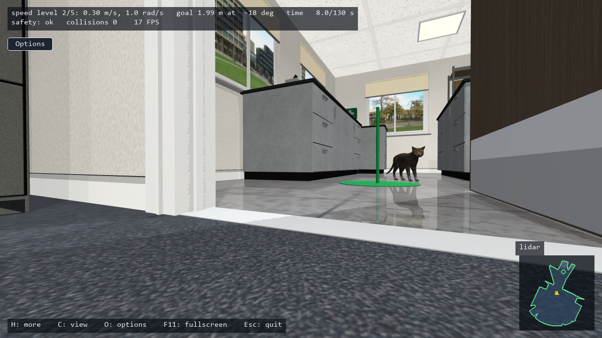

# Autonomous Robot Environment

[Back to Projects](../projects.md) · [Back to README](../README.md)

A simulation-first MuJoCo environment for a differential-drive robot in a furnished office.

## What I Built

- Robot model with lidar, camera observations, and wheel encoders
- Office scenes with furniture, doorways, and dynamic cat obstacles
- Manual control, baseline navigation, and a Gymnasium interface
- Command-boundary safety intervention and navigation telemetry

## Simulation Screenshots

### Reception area

Reception scene showing the robot, camera inset, lidar panel, and navigation telemetry.

### Corridor navigation

Corridor scene with open doorways and a cat obstacle ahead.

### Sitting cat obstacle

A sitting cat in front of the robot, shown in both the external view and camera inset.

### Robot-camera view of the laboratory

Low-mounted camera view of the laboratory and goal marker.

### Cat visible from the robot camera

Camera view of a cat near the goal marker, with navigation telemetry and lidar visualization.

## Status and Evaluation

The project supports local navigation experiments and controller development. A safety layer is an implemented mechanism, not a guarantee of collision-free operation. Simulation results do not establish physical-robot performance or observation-only autonomous navigation.

## Technology

Python, MuJoCo, Gymnasium, NumPy, Numba, Pygame, pytest.

## Evidence

- [Source repository](https://github.com/CS-Ponkoj/Autonomous-Robot-Environment)
- [Portfolio case study](https://ponkoj.com/case-studies/autonomous-robot-environment)
